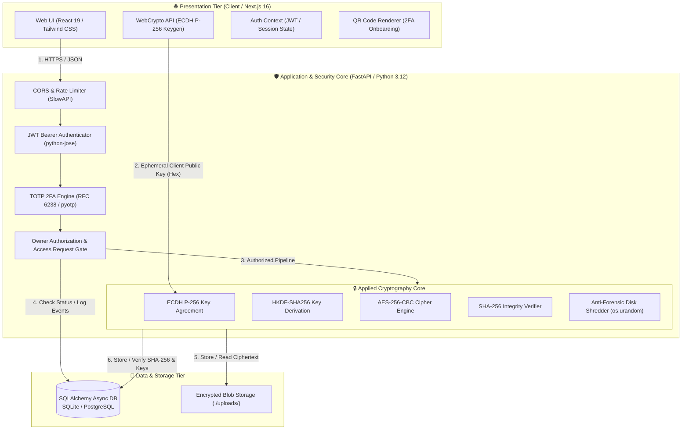
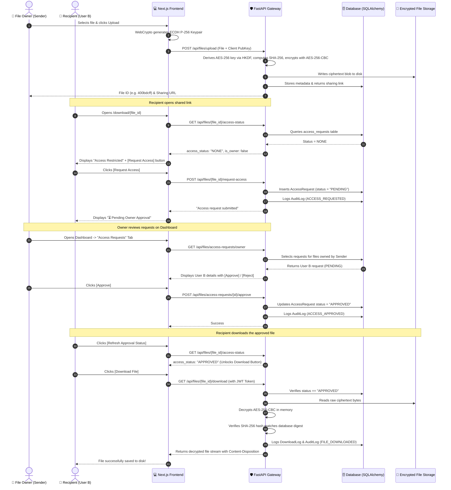
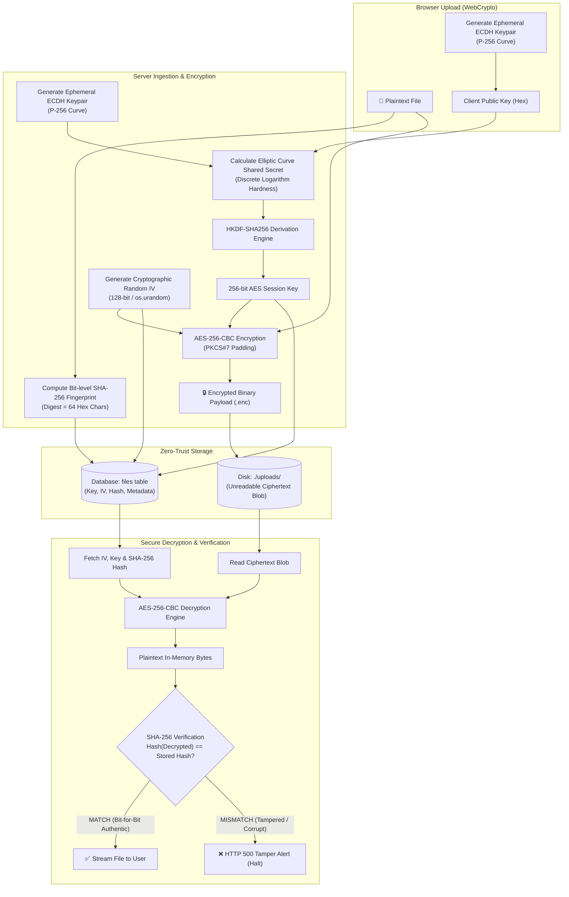
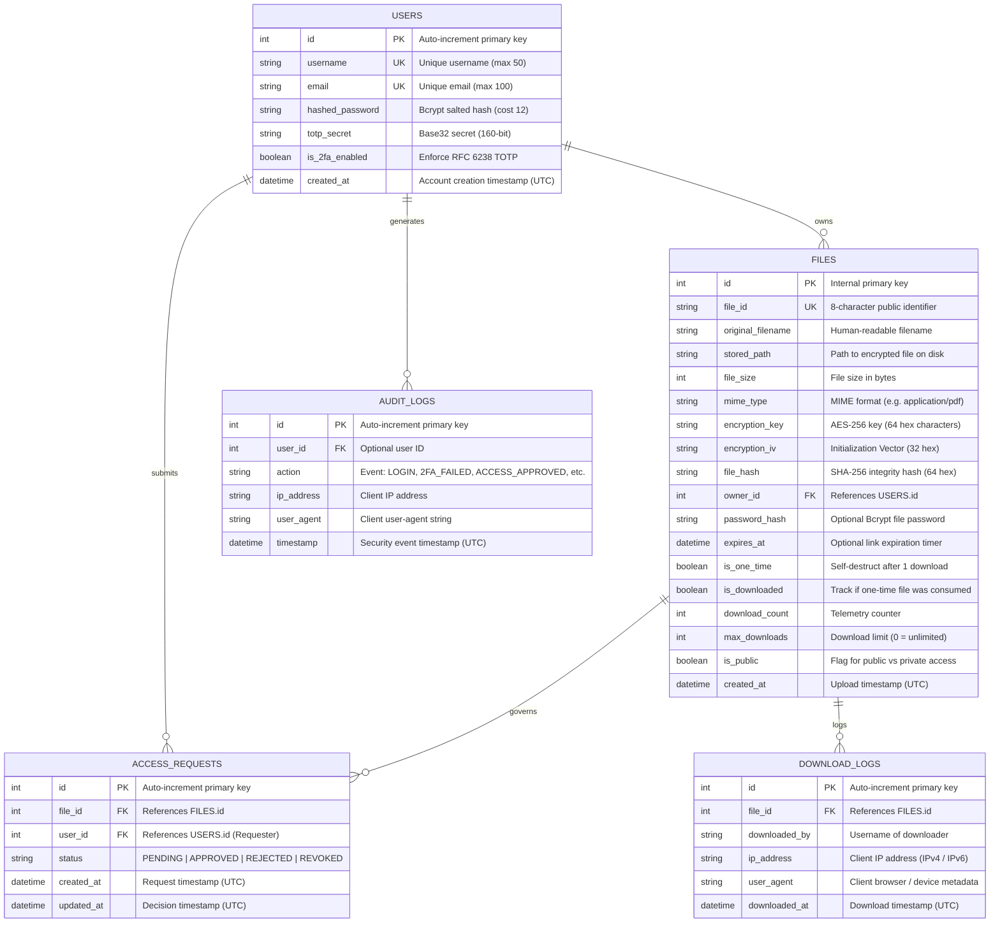

# 🏛️ SecureShare — Complete Architecture Diagrams & Specifications

This document provides visual architectural diagrams using **Mermaid.js** standard notation. These diagrams can be previewed directly in GitHub, IDE Markdown previewers, or exported into presentation slides via [Mermaid Live Editor](https://mermaid.live).

---

## 1. High-Level 3-Tier System Architecture

This diagram illustrates the decoupling between the Client Presentation Tier, the FastAPI Application & Security Core Tier, and the Persistent Data & Storage Tier.

---

## 2. Access Request & Owner Approval Flow (Sequence Diagram)

This sequence diagram depicts how shared files remain restricted until the file owner reviews and grants permission to a specific recipient.

---

## 3. Cryptographic Data Flow Architecture

A detailed look at the applied cryptographic algorithms guarding confidentiality, authenticity, and integrity across the transport and storage layers.

---

## 4. Entity-Relationship Diagram (Database Architecture)

This ER diagram illustrates the database models, relations, primary/foreign keys, and data types enforced in `backend/app/models.py`.

---

## 5. Security Defense-in-Depth Model

```mermaid
graph LR
    subgraph Layer1 ["1. Network & Transport"]
        MitM["MitM Prevention (ECDH P-256)"]
        TLS["HTTPS / TLS Transport Security"]
        RateLimit["Rate Limiting (SlowAPI - 5/min)"]
    end

    subgraph Layer2 ["2. Identity & Access"]
        Bcrypt["Bcrypt Password Hashing + Salts"]
        TOTP["Google Authenticator TOTP 2FA"]
        JWT["HMAC-SHA256 Bearer Token"]
        Approval["Owner-Mediated Access Approval"]
    end

    subgraph Layer3 ["3. Payload Confidentiality & Integrity"]
        AES["AES-256-CBC Payload Encryption"]
        HKDF["HKDF-SHA256 Uniform Key Derivation"]
        SHA["Bit-for-Bit SHA-256 Integrity Fingerprint"]
        OneTime["One-Time Download Invalidation"]
    end

    subgraph Layer4 ["4. Data-at-Rest & Anti-Forensics"]
        Disk["Zero-Plaintext Ciphertext Blobs"]
        Shred["DoD 5220.22-M Sector Overwrite (os.urandom)"]
        Audit["Immutable SIEM-Ready Audit Telemetry"]
    end

    Layer1 --> Layer2 --> Layer3 --> Layer4
```

