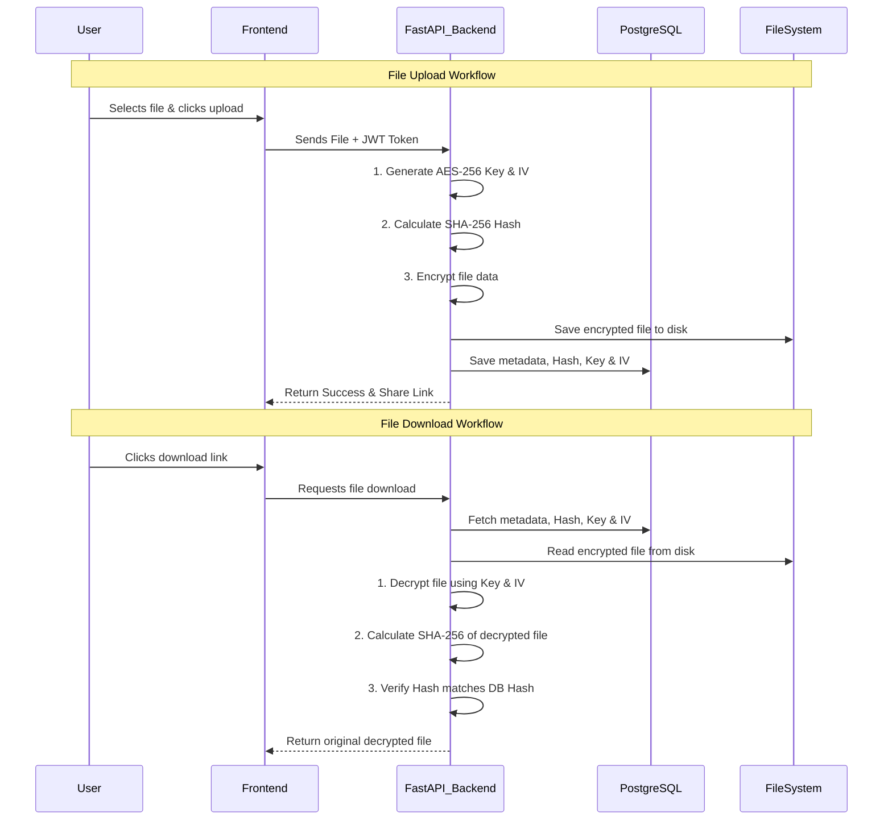

# SecureShare: Project Review 1 Documentation

This document contains all the necessary information to achieve an "Excellent (8-10)" score for your **Design and Implementation** review based on the provided rubric.

---

## 1. Problem Identification & Requirement Analysis

### 1.1 Problem Identification
In today's digital landscape, users constantly share sensitive files (such as personal records, corporate documents, and academic data) over the internet. Standard file-sharing platforms often lack robust, built-in cryptographic protections, leaving data at rest vulnerable to server-side breaches, unauthorized access, and data tampering. There is a critical need for a localized, highly secure file-sharing platform that guarantees data confidentiality, integrity, and controlled access.

### 1.2 Objectives
*   **Confidentiality:** Ensure that all uploaded files are securely encrypted at rest so that even if the server storage is compromised, the files remain unreadable.
*   **Integrity:** Guarantee that files are not altered or corrupted while stored on the server.
*   **Authentication & Access Control:** Restrict file access to authorized users and provide mechanisms for secure, temporary sharing (e.g., expiring links, one-time downloads).
*   **Usability:** Provide a modern, user-friendly web interface that abstracts the complex cryptographic operations away from the end-user.

### 1.3 Requirement Analysis & Justification
*   **Functional Requirements:**
    *   User Registration & Login (Authentication).
    *   Secure file upload and download functionality.
    *   Dashboard for users to manage, share, and track their files.
    *   File access controls (password protection, one-time downloads).
*   **Security Requirements (Core CNS focus):**
    *   *Requirement:* Secure Password Storage. *Justification:* Passwords must never be stored in plain text. We use **Bcrypt** because its built-in salt and computational cost prevent dictionary and brute-force attacks.
    *   *Requirement:* Data at Rest Encryption. *Justification:* To ensure confidentiality, all files must be encrypted before being saved to the disk using **AES-256-CBC**, an industry-standard symmetric encryption algorithm.
    *   *Requirement:* Data Integrity Verification. *Justification:* To prevent tampering, a **SHA-256** hash is generated upon upload and verified upon download.
*   **Non-Functional Requirements:**
    *   *Performance:* The system should encrypt/decrypt files efficiently without significant lag.
    *   *Scalability:* The backend (FastAPI) and database (PostgreSQL) must be containerized (Docker) for easy deployment and scaling.

---

## 2. Design and Planning

### 2.1 System Architecture
The project follows a modern, decoupled Client-Server architecture:
*   **Frontend (Client):** Built with Next.js (React) and Tailwind CSS. It handles the user interface, file selection, and API communication.
*   **Backend (Server):** Built with FastAPI (Python). It handles the cryptographic operations (encryption/decryption/hashing), business logic, and JWT authentication.
*   **Database:** PostgreSQL, used to store user credentials (hashed), file metadata, and cryptographic keys.

### 2.2 Security Mechanisms
1.  **Authentication:** JSON Web Tokens (JWT) are used for stateless API authentication.
2.  **Password Hashing:** Bcrypt algorithm.
3.  **Symmetric Encryption:** AES-256-CBC (Advanced Encryption Standard with a 256-bit key in Cipher Block Chaining mode) is used for file encryption. A unique Key and Initialization Vector (IV) are generated for every single file.
4.  **Cryptographic Hashing:** SHA-256 is used for file integrity checks.

### 2.3 Workflow Diagram
Below is the workflow for the core File Upload and Download process:

### 2.4 Task Allocation & Planning
*(Note: Adjust the names/roles below based on your actual team size. If you are doing this alone, you can state that you acted as the Full-Stack Security Engineer handling all phases).*

*   **Team Member 1 (Frontend & UI/UX):** Responsible for Next.js setup, building the responsive Dashboard, Upload/Download interfaces, and integrating API calls securely.
*   **Team Member 2 (Backend Security & Crypto):** Responsible for FastAPI setup, implementing AES-256-CBC encryption logic, SHA-256 hashing, Bcrypt password hashing, and JWT token generation.
*   **Team Member 3 (Database & Infrastructure):** Responsible for PostgreSQL schema design, Docker containerization (`docker-compose`), and managing the file storage system logic.

---

### Tips for your presentation tomorrow:
1. When discussing **Requirement Analysis**, emphasize *why* you chose AES-256 and Bcrypt. Professors love it when you justify your cryptographic choices.
2. Show them the **Workflow Diagram** to clearly explain how the keys are generated and how the file is protected at rest.
3. If they ask why you didn't use E2EE (End-to-End Encryption), explain that for this scope, a **Server-Side Encryption (SSE)** model was chosen to demonstrate core cryptographic implementations (AES, SHA) natively on the backend while keeping the frontend lightweight.
